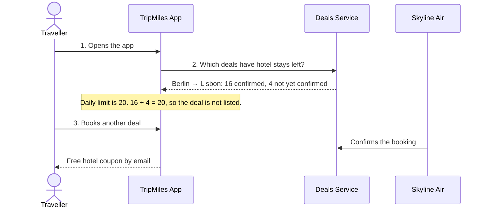

# TripMiles: pre-interview task

TripMiles is a small app that shows travel deals to travellers.

You are on the **Offers team**. Your team builds the list of deals that a traveller sees.

> **Note:** This is not a ticket booking system. TripMiles shows **deals**: anyone who books a flight
> through TripMiles gets a **free one-night hotel stay**. Each deal can give away only a limited number
> of hotel stays per day. Once the limit is reached, the deal must disappear from the list.

1. The traveller opens the app to see travel deals from different airlines.
2. The app lists only the deals that still have hotel stays left.
3. The traveller books. When the airline confirms the booking, the traveller gets a free hotel coupon by email.

The app works, but the budget check in step 2 is missing.
Your task is to write it so that all four rules pass.

- **Time:** about 1 to 2 hours.
- **Tools:** use any tools that you like, including AI.
- **Interview:** you explain your changes and why you made them.
  Then we talk about how the same design works at a much larger scale.

## Words used in this task

- **Partner:** an airline. Skyline Air is a partner.
- **Deal:** an offer from a partner. Each booking gives the traveller one free hotel stay.
- **Daily limit:** the most hotel stays one deal gives away in one day.
- **Partner daily limit:** the most hotel stays all deals of one partner give away together in one day.
- **Confirmation:** a message from the partner that says a booking is valid.
  A confirmation arrives a few minutes after the booking.
- **Unconfirmed booking:** a valid booking whose confirmation has not arrived yet. It still counts.
- **Deals Service:** the service that counts bookings and confirmed bookings.
  All 4 app servers use this one service.
- **Request:** one call from an app server to the Deals Service.
  Each request goes over the network, so each request is slow.
  Sometimes the service does not answer a request.

## Example



## Who owns what

| Folder | Team | What it does |
|---|---|---|
| `deals/` | Partner Management | Stores the daily limit of each deal and each partner. |
| `feed/feed.go` | Offers (your team) | Builds the list of deals for one app open. |
| `feed/checks.go` | Offers (your team) | The budget check. **Complete this file.** |
| `dealsvc/` | Platform | The Deals Service. Counts bookings. Each request is slow. Sometimes it does not answer. |
| `cmd/sim/` | none | Runs one busy day on 4 servers. Then it checks the four rules. |

You can change other files too. If you do, be ready to explain why.

## The four rules

1. Each app open sends at most 1 request to the Deals Service.
2. 99 of 100 app opens take 15 ms or less.
3. No deal and no partner goes over 105% of its daily limit.
   This must be true when confirmations arrive late.
   It must also be true when the Deals Service does not answer.
4. Deals with stays left stay on the list.

## Run it

You need Go 1.24 or newer. You do not need Docker or a network connection.

1. Go to the task folder:
   ```sh
   cd tripmiles
   ```
2. Run the tests:
   ```sh
   go test ./...
   ```
3. Run the simulated day:
   ```sh
   go run ./cmd/sim
   ```
4. Run the tests with the race detector:
   ```sh
   go test -race ./...
   ```

Today, 4 tests fail and 2 tests pass. The simulator shows `FAIL` for rule 3.

## You are done when

- [ ] `go test ./...` shows no failures.
- [ ] `go run ./cmd/sim` shows `PASS` for all four rules.
- [ ] `go test -race ./...` shows no data races.
- [ ] You can explain each change that you made.
