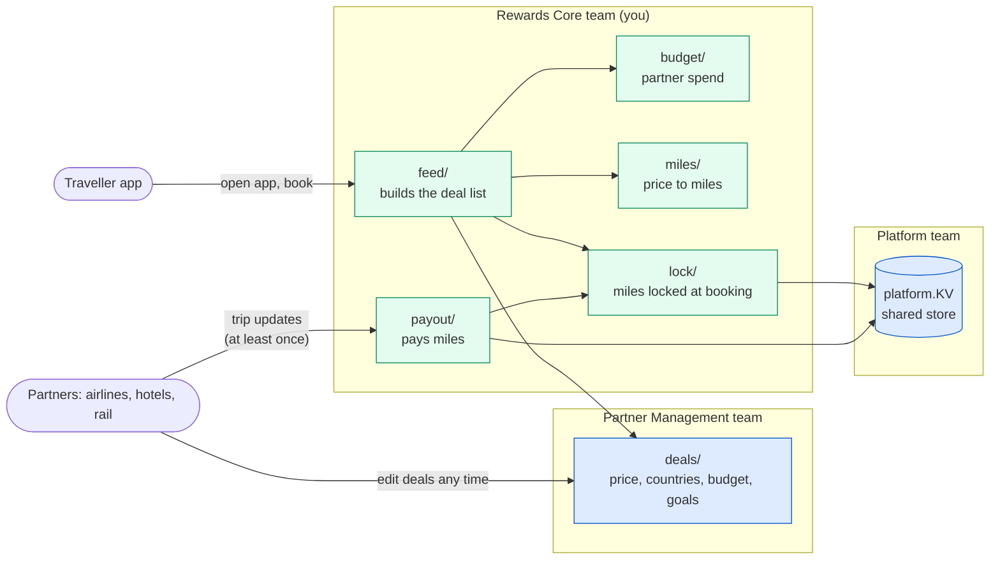

# TripMiles — pre-interview task

TripMiles is a small travel rewards backend. Airlines, hotels and rail
companies (**partners**) pay us for every booking we bring them. Travellers
open the app, see deals with the **miles** they will earn for each trip goal
(check-in, trip completed), book one, and get paid miles when the partner tells
us they reached a goal.

You are on the **Rewards Core** team. Two functions are not written yet.

**Time: about 1–2 hours. Use any tools you like, including AI.**
We care that you understand *why* your solution works; we will build on it
together in the interview.

## Run it

Needs Go 1.24+. No Docker, no network.

```sh
cd tripmiles
go test ./...        # the rules as tests
go run ./cmd/sim     # a busy hour of traffic; prints one CHECK line per rule
```

Done = both pass. Also try `go test -race ./...`.

## How it fits together



## The rules

1. **Miles come from the partner's price.**
   `miles = price × (1 − fee) × miles per USD` — already written in `miles/`.
2. **Miles are locked at booking.** When a traveller books, we store the miles
   per goal (`lock/`, already written). Partners can change a deal at any time;
   that must not change what an existing booking is paid.
3. **Pay each goal exactly once.** Partner updates come from a queue that
   delivers *at least once*: the same update can arrive twice, at the same
   time, on different server instances. The instances share only the KV store
   (`platform/`).
4. **Never spend more than a partner's budget.** Spend is kept in a shared
   store that is sometimes unavailable, and every lookup is a network call.

## What to write

| File | Function | Rules |
|---|---|---|
| `payout/payout.go` | `Pay` | 2, 3 |
| `budget/budget.go` | `Filter` | 4 |

Everything else is there to help you. Change it if you need to, but be ready to
explain why.

## In the interview (45 min)

1. You walk us through your solution (about 10 min).
2. We extend it together, live, AI allowed (about 20 min).
3. We talk about shipping it safely: rollout, monitoring, what "done" means.

No need to prepare anything else.
