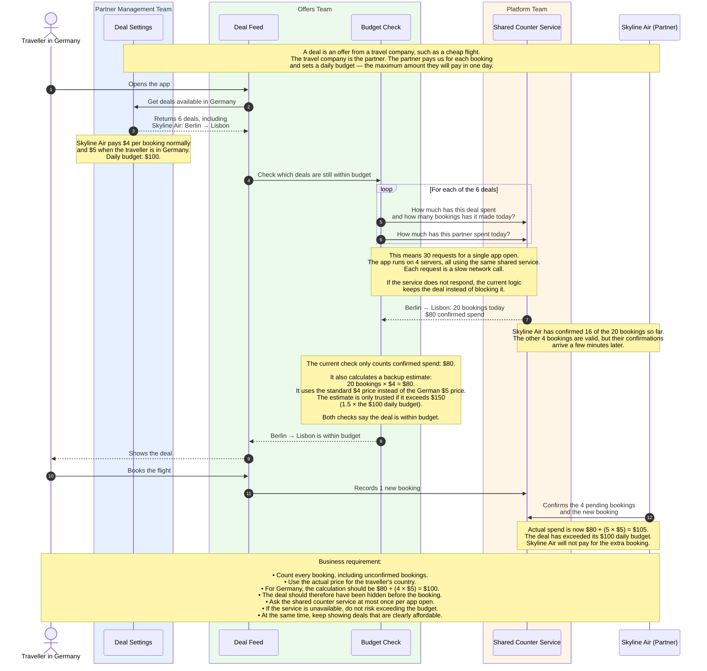

# TripMiles — pre-interview task

TripMiles shows travellers a list of travel deals, such as cheap flights and hotel
nights. Travel companies, which we call **partners**, pay us a fixed price every
time a traveller books one of their deals. Each partner also sets a **daily
budget** for each deal: the most they will pay us for that deal in one day.

You are on the **Offers team**. Your team builds the list of deals that a traveller
sees when they open the app. You must never show a deal whose budget is already
used up, because the partner will not pay for bookings over budget.

The app works today. Under real traffic, though, it asks the shared counter service
far too many questions, it is slow, and some deals go over their budget.

**Time:** about 1–2 hours. Use any tools you like, including AI. In the interview
you will walk us through your changes and why you made them, and then we will talk
about how this would work at a much larger scale.

## How it works today

The example below follows one traveller in Germany who opens the app.



Where the 30 requests come from: the budget check asks four questions for each
deal (money confirmed and number of bookings, both for today and in total), and one
more question about the partner. Six deals times five questions is 30.

## Who owns what

| In the diagram | Folder | Team | What it does |
|---|---|---|---|
| Deal Settings | `deals/` | Partner Management | Stores each deal's price, its price in each country, and its budgets. Also stores each partner's daily limit for all its deals together. |
| Deal Feed | `feed/feed.go` | Offers (you) | Builds the list of deals a traveller sees. |
| Budget Check | `feed/checks.go` | Offers (you) | Leaves out deals whose budget is used up. **This is the code to improve.** |
| Shared Counter Service | `stats/` | Platform | Remembers bookings and confirmed money. All app servers share it. Every question to it is a slow network call, and sometimes it does not answer. |
| — | `cmd/sim/` | — | Plays one busy day and checks the rules below. |

You may change any file if you need to, but be ready to explain why.

## Make these four rules true

1. Each time a traveller opens the app, the shared counter service is asked at most once.
2. Opening the app is fast: 99 out of 100 app opens take 15 ms or less.
3. No deal, and no partner, goes more than 5% over its daily budget, even when
   confirmations arrive late and the counter service sometimes does not answer.
4. Travellers always see the deals that can still be afforded.

## Run it

You only need Go 1.24 or newer. No Docker and no network are needed.

```sh
cd tripmiles
go test ./...        # the rules as small tests
go run ./cmd/sim     # one busy day; prints PASS or FAIL for each rule
```

Today, three tests fail, and the simulator shows three of the four rules failing.
You are done when every test passes and the simulator prints PASS four times.
Please also run `go test -race ./...`.
