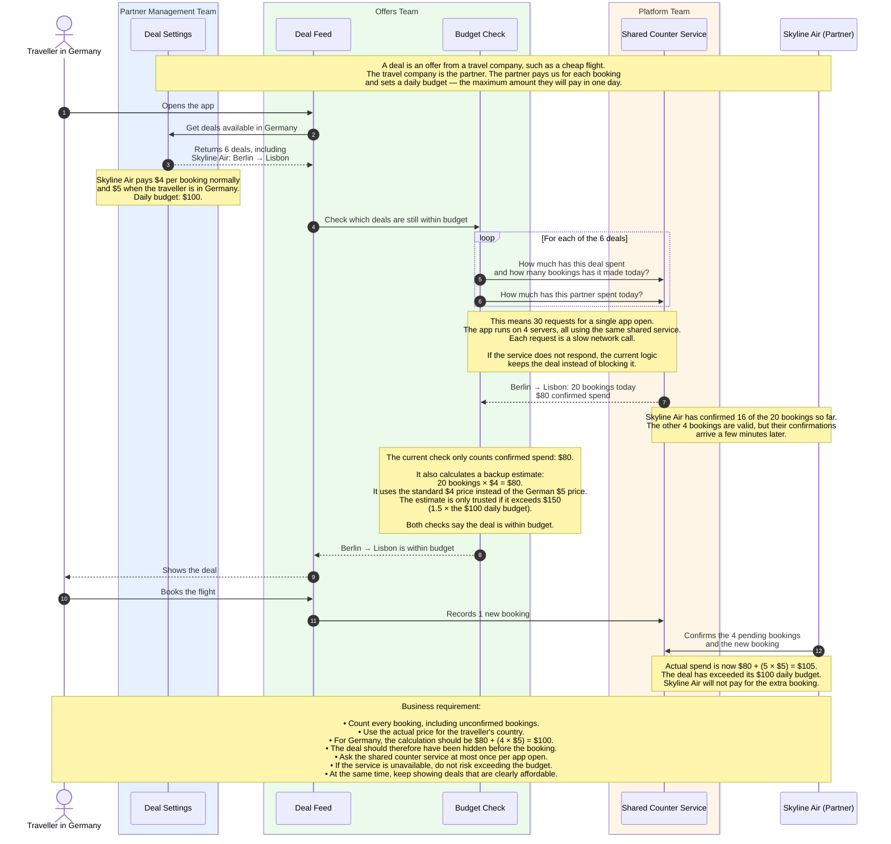

# TripMiles: pre-interview task

TripMiles is a small app that shows travel deals to travellers.
You are on the **Offers team**. Your team builds the list of deals that a traveller sees.

The app works. But under real traffic, three of its four rules fail.
Your task is to change the code so that all four rules pass.

- **Time:** about 1 to 2 hours.
- **Tools:** use any tools that you like, including AI.
- **Interview:** you explain your changes and why you made them.
  Then we talk about how the same design works at a much larger scale.

## Words used in this task

- **Partner:** a travel company, for example an airline. Skyline Air is a partner.
- **Deal:** an offer from a partner, for example a cheap flight.
- **Price:** the amount that the partner pays us for one booking.
  Some countries have a different price. For example, travellers in Germany cost $5, not $4.
- **Daily budget:** the most that the partner pays for one deal in one day.
  When the budget is used, the deal must not be on the list.
- **Partner daily limit:** the most that a partner pays for all its deals together in one day.
- **Confirmation:** a message from the partner that says a booking is valid.
  A confirmation arrives a few minutes after the booking.
- **Confirmed spend:** the money from bookings that the partner has confirmed.
- **Unconfirmed booking:** a valid booking whose confirmation has not arrived yet.
- **Shared counter service:** the service that counts bookings and confirmed spend.
  All 4 app servers use this one service.
- **Request:** one call from an app server to the shared counter service.
  Each request goes over the network, so each request is slow.
  Sometimes the service does not answer a request.

## How it works today

The diagram follows one traveller in Germany who opens the app.



The diagram shows 30 requests for one app open. They come from two checks:

- The **deal budget check** sends 4 requests for each deal:
  confirmed spend today, bookings today, confirmed spend in total, and bookings in total.
- The **partner limit check** sends 1 request for each deal.
- 6 deals × 5 requests = 30 requests.

## Who owns what

| Name in the diagram | Folder | Team | What it does |
|---|---|---|---|
| Deal Settings | `deals/` | Partner Management | Stores the price, the country prices and the budgets of each deal. Stores the partner daily limit of each partner. |
| Deal Feed | `feed/feed.go` | Offers (your team) | Builds the list of deals for one app open. |
| Budget Check | `feed/checks.go` | Offers (your team) | Contains the deal budget check and the partner limit check. **Change this file.** |
| Shared Counter Service | `stats/` | Platform | Counts bookings and confirmed spend. Each request is slow. Sometimes it does not answer. |
| (not in the diagram) | `cmd/sim/` | none | Runs one busy day on 4 servers. Then it checks the four rules. |

You can change other files too. If you do, be ready to explain why.

## The four rules

1. Each app open sends at most 1 request to the shared counter service.
2. 99 of 100 app opens take 15 ms or less.
3. No deal and no partner spends more than 105% of its budget.
   This must be true when confirmations arrive late.
   It must also be true when the shared counter service does not answer.
4. Affordable deals stay on the list.

## Run it

You need Go 1.24 or newer. You do not need Docker or a network connection.

1. Go to the task folder:
   ```sh
   cd tripmiles
   ```
2. Run the tests:
   ```sh
   go test ./...
   ```
3. Run the simulated day:
   ```sh
   go run ./cmd/sim
   ```
4. Run the tests with the race detector:
   ```sh
   go test -race ./...
   ```

Today, 3 tests fail and 3 tests pass. The simulator shows `FAIL` for rules 1, 2 and 3.

## You are done when

- [ ] `go test ./...` shows no failures.
- [ ] `go run ./cmd/sim` shows `PASS` for all four rules.
- [ ] `go test -race ./...` shows no data races.
- [ ] You can explain each change that you made.
